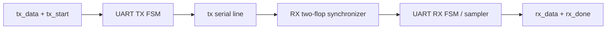

# Design notes

## Top-level connection

## Transmitter sequence

The transmitter has four states: `IDLE`, `START`, `DATA`, and `STOP`.

- **IDLE:** holds `tx` high. A `tx_start` pulse copies `tx_data` into the shift register.
- **START:** drives the line low for one bit period.
- **DATA:** places bit 0 of the shift register on `tx`; after each bit period it shifts right. This sends the byte LSB first.
- **STOP:** drives the line high for one bit period, returns to IDLE, and pulses `tx_done`.

`tx_busy` is high whenever the state is not IDLE.

## Receiver sequence

The external `rx` signal is asynchronous to the local clock. `rx_sync1` and `rx_sync2` reduce the chance that metastability reaches the state machine. The receiver then:

1. Detects a low line in IDLE.
2. Waits half a bit and checks that the start bit is still low.
3. Samples eight data bits one bit interval apart into the shift register.
4. Checks that the stop bit is high.
5. Copies the byte to `rx_data` and pulses `rx_done` for a valid frame; otherwise sets `rx_error`.

## Bit timing

The RTL calculates `CLKS_PER_BIT = CLK_FREQ / BAUD_RATE`. In the loopback test, 1 MHz / 100 kbaud = 10 clocks per bit. An 8N1 frame contains 10 bit periods, so one frame takes 100 clock cycles in this simulation.

Integer division is simple and adequate for this test setup, but a real implementation should choose clock and baud values carefully and verify timing tolerance.
